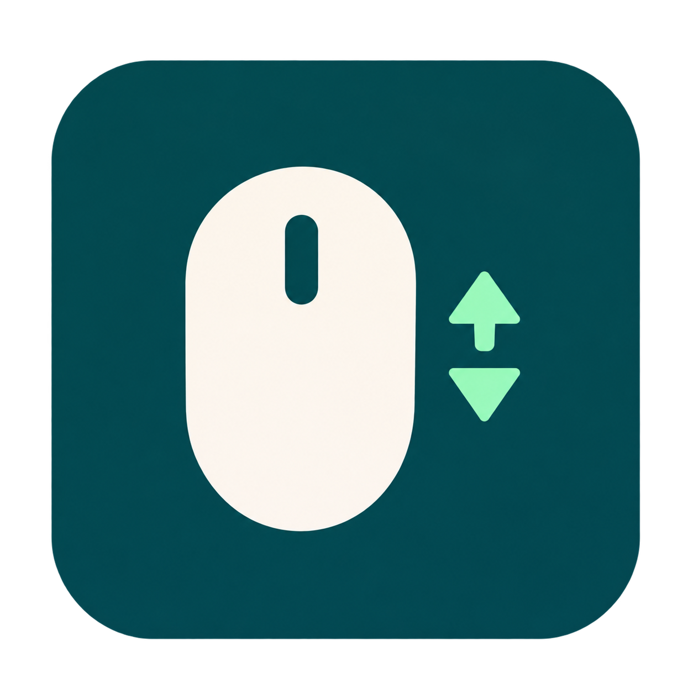

# MouseFlip



MouseFlip is a native macOS menu bar app with independent scrolling directions for mouse and trackpad. Use the two **Natural scrolling** checkboxes to select a direction for each device. Hover over the menu bar icon to see the detected device and its scrolling direction.

## Build and run

Requires macOS 13 or later and Xcode command line tools with Swift 5.9 or later.

```sh
swift test
./scripts/build.sh
```

Copy `dist/MouseFlip.app` into your Applications folder and open it. Grant the installed copy access in **System Settings → Privacy & Security → Accessibility**. Local builds are ad hoc signed, so rebuilding can require removing and re-adding the app in Accessibility. Choose **Launch at Login** in the app menu to start it automatically.

## Device detection

MouseFlip reads HID registry metadata and uses the scroll event’s sender when available. Some drivers omit the sender. With a mouse connected, ambiguous pixel-based events appear as **Smooth input**. The menu option **Treat unidentified smooth input as mouse** chooses which device preference applies to those events.

MouseFlip applies the selected direction to horizontal and vertical scroll events. Quitting restores the normal macOS behavior. Diagnostics in `~/Library/Application Support/MouseFlip/status.json` contain current status, detected device names, and aggregate counters.

## License

MouseFlip is licensed under the [MIT License](LICENSE).
